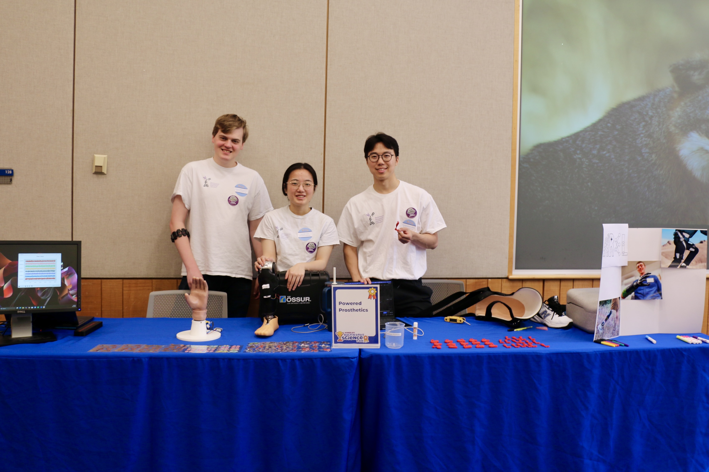
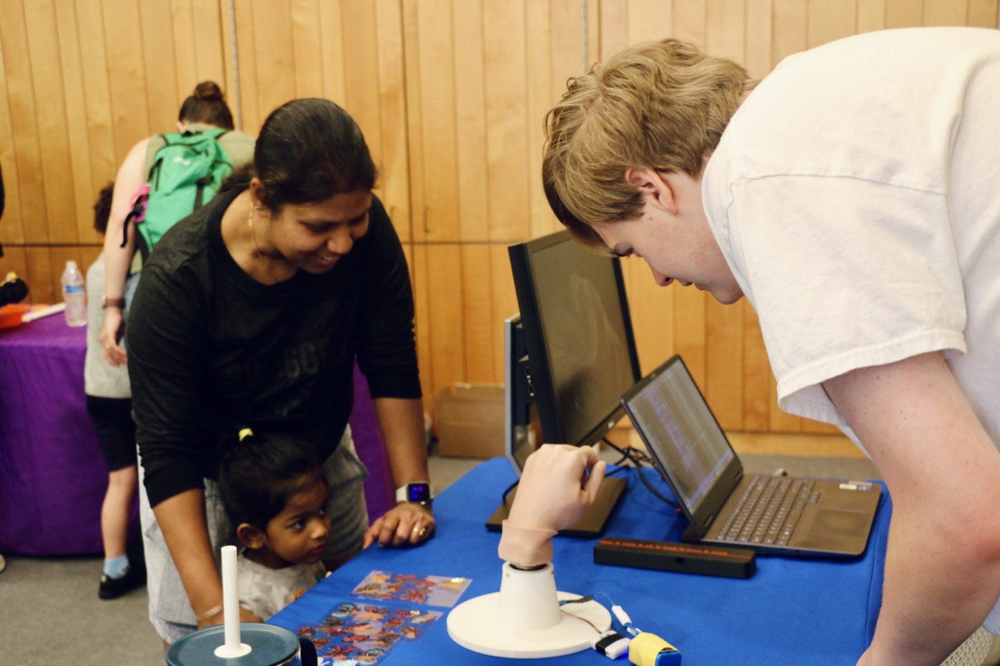
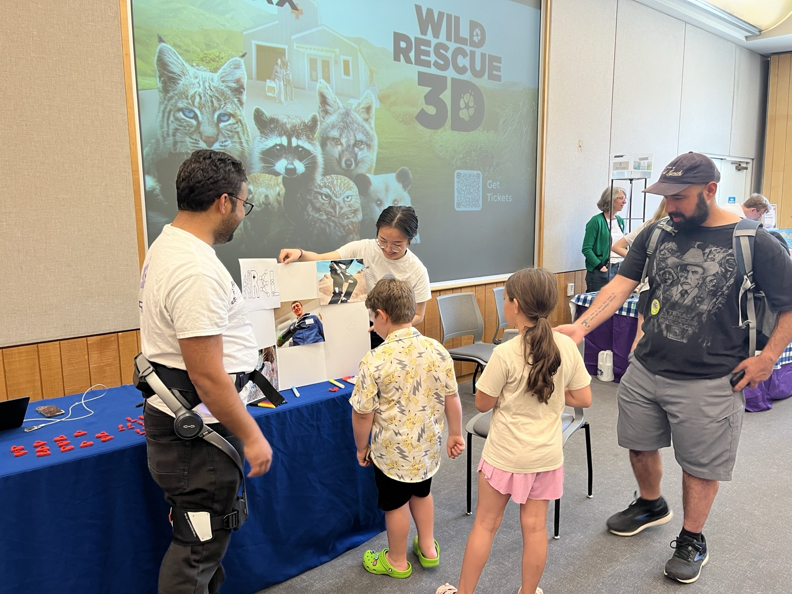
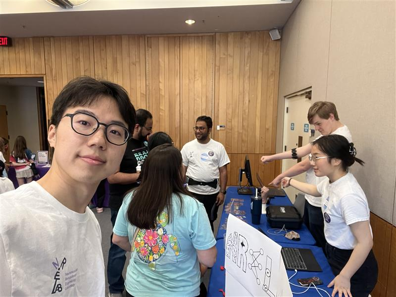

At the Marbles Backwards Science Fair, we ran a Powered Prosthetics table and showed visitors how wearable robots can improve quality of life. We brought a powered prosthetic leg and a prosthetic hand to try, along with a poster of wearable robots in daily life.

Read more in the [LinkedIn post](https://lnkd.in/p/eRGH5vnz).

*Our Powered Prosthetics table at the Marbles Backwards Science Fair*

*The Backwards Science Fair at Marbles Kids Museum*

*Trying out the prosthetic hand demo*

*Showing visitors a wearable robot and our poster*

*The team at our table*
